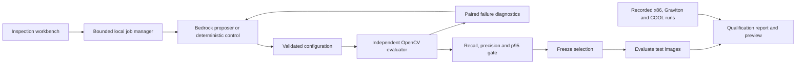

# VisionProof build plan

VisionProof qualifies a classical OpenCV circuit-board inspection pipeline before a developer
deploys an optimization. A configuration proposer may trade compute for speed; an independent
evaluator decides whether the resulting defect boxes still meet the declared quality contract.

## Demo contract

The developer opens an inspection workbench, sees the original defect detections and timing,
examines a fast candidate that missed defects, and follows a measured search to a qualified
configuration. They inspect the same board before and after, compare actual AWS measurements,
then download the configuration, source fingerprints, and report needed to reproduce the result.

The decisive moment is a failed quality gate: faster processing cannot compensate for missed
defects. All displayed evidence must come from a real saved experiment or a live evaluation.
Recorded experiment playback must be labeled. A rules controller must be labeled as rules.

## Components and boundaries

1. Dataset loader verifies the pinned DeepPCB commit, per-file hashes, and board-group splits.
2. The pipeline aligns grayscale template/inspection pairs and outputs class-agnostic boxes.
3. Evaluator performs one-to-one IoU matching, computes misses, and measures warm batches.
4. Diagnostics compare the candidate with baseline on the same development images. They
   count lost and recovered matches, bucket errors by defect size, and identify expensive stages.
5. The model proposes a change to one previously measured configuration. It receives summaries
   and diagnostic facts, never test images or tools that edit source or acceptance requirements.
6. Experiment runner saves raw decisions and measurements, an append-only hash-linked event
   journal, a frozen selection, equal-budget sweep results, and the subsequent test verdict.
7. Workbench reads verified saved evidence and runs one bounded local qualification job at a time.
8. Cloud runner transfers only source, selected benchmark inputs and configuration, records runtime
   provenance, then terminates its worker and deletes its SSH key and security group.

Logical isolation does not sandbox hostile Python. This version accepts bounded configurations
for two explicit pipeline adapters, not arbitrary repositories, arbitrary shell commands, or public uploads.

## Developer workflow and replication extension

The `adapters.py` registry contains exactly two reviewed adapters. It supplies the bounded config,
detector, evaluator, runtime fingerprint, search space and planner instructions. PCB measurement
and scoring source remain unchanged so historical PCB evidence remains reproducible. The second
adapter uses OpenCV Zoo's pinned YOLOX ONNX model and OpenCV DNN CPU on Penn-Fudan single images.
It derives label boxes from public instance masks and declares Fudan development / Penn test
before experiments. The browser uses the same inspection surface, gate, journal and qualification
controls for either adapter; it resolves datasets through registered runs rather than user paths.

`vision-proof check` is a build step with explicit exit states: pass 0, regression 2, invalid/error 3.
The caller supplies a frozen baseline and candidate configuration. A fixed-seed shuffled rotation
schedule balances their positions across repeated measurement blocks. The runner writes a
hash-bound contract before opening the test evaluator, preserves raw measurements, checks
detector determinism, computes paired speedup bootstrap intervals and per-group quality, and
exports Markdown/JSON and lost detections. A regression leaves a report and a failing process.
An interrupted or invalid job cannot provide a passing summary. Outputs never overwrite prior evidence.

The GitHub Actions workflow uses no cloud secrets or paid APIs, tests both adapters, reads the
configuration baseline from the PR base, and attaches the report even on failure. It compares
bounded configuration changes in the current implementation. It does not sandbox malicious
code, compare arbitrary implementation revisions or activate repository branch protection.

The stronger PCB study freezes the previously selected Bedrock and sweep configurations, excludes
all prior image IDs, and uses three source-board groups outside earlier development/test searches.
Those groups had baseline calibration measurements, so they are calibration-exposed boards,
not unseen boards. Every previously registered image is excluded. Report all group sizes, all failures and the interval against the sweep.
Never reinterpret repeated frozen-config evaluation as proof that the LLM searches better.

The workbench adds one CI/replication view with a registered-study selector, interval plot, gate
table, per-source quality, inspection image and downloadable evidence. The visual system retains
the existing navy/teal/coral inspection language; uncertainty and lost detections carry the emphasis.
The recorded demo must show a real blocked command, its missed detection, a passing command,
the second detector and the replicated comparison with its limits.

Acceptance checks cover real OpenCV detection loss despite improved speed, CI exit codes,
balanced schedule and freeze ordering, raw-result binding and summary tampering, reserved-group
and prior-image exclusion, neural decode correctness, both adapters' inference/export/jobs, mobile
layout, and a fresh walkthrough recording. Network/model artifacts stay outside the repository.

## Experiment protocol

- The original 240 images and all earlier experiments remain historical evidence.
- A second manifest excludes every original image. Development and test use disjoint groups
  drawn from the former calibration groups. These are new images, not wholly unseen source boards.
- The manifest and sampling method are saved before either candidate search or test evaluation.
- Fixed requirements: no more than 0.02 absolute loss in recall or precision; warm p95 no more
  than 1.25 times baseline. These are empirical tolerances, not industrial safety guarantees.
- Default experiment budget is four proposals per method. Fixed sweep order is declared in code.
- Select using development results, write selection and its digest, then instantiate test evaluator.
- Keep baseline eligible as a fallback. A failed test candidate is refused preview promotion.
- Record model usage, raw structured tool input, hypotheses, protocol errors and observed outcomes.
- Never attribute deterministic tuning gains to an LLM. One successful run does not prove search
  superiority; disclose the equal-budget control, ordering effects and finite sample limitations.

## Workbench experience

Desktop layout has a narrow run navigator, a dominant image-comparison surface, and an evidence
inspector. Mobile stacks those regions. A dark navy tool strip anchors a cool-gray workspace;
teal, amber and coral encode matched detections, predictions and misses respectively.

### Inspection

- Choose a measured run and a board example.
- Compare baseline and selected predictions on identical pixels.
- Toggle annotation and prediction overlays independently.
- Hover or select a missed annotation to inspect its crop and before/after matching result.
- Run the frozen detector again and show fresh wall-clock inference time separately from batch timing.

### Experiments

- View each proposal, hypothesis, measured metrics and failed checks.
- Inspect paired lost/recovered matches and stage costs.
- Scatterplot visualizes throughput versus recall with acceptance floor and selected candidate.
- Guided playback reveals saved experiments in order and explicitly identifies recorded evidence.
- Start a local rules or configured Bedrock run; show progress from persisted events, never fabricated progress.
- One active job prevents concurrent benchmarks from corrupting timing through local contention.

### Deployment report

- Compare actual x86 pip, Graviton pip, and entitled COOL worker evidence.
- Show instance type, runtime, NumPy, batch scope, quality and current fetched compute rate.
- Explain COOL's different OpenCV/NumPy versions; do not call the measured difference an isolated library effect.
- Expose configuration/report JSON exports and a reproducibility archive.
- Show verified termination and Marketplace cancellation separately from benchmark success.

## HTTP contract

Existing health, evidence, trace, image and predict routes remain supported.
New catalog routes expose only registered, verified runs below a configured evidence directory.
Dataset paths and credentials never appear as arbitrary file-serving routes.

POST qualification uses an exact allowlist, bounded budgets/repeats and configured model ID.
Bind to loopback, check Host and Origin on mutations, reject large/unknown input, and return
specific errors. GET requests never invoke paid models. The browser never receives credentials.
All dynamically rendered model text uses text nodes. No raw model HTML is executed.

## Verification and delivery

1. Unit tests for paired diagnostics, protocol parsing, journal tampering, group exclusion,
   state transitions, source/config binding, HTTP validation and refusal of invalid promotion.
2. Real Bedrock search on the new manifest, with the same sweep budget and independent test gate.
3. Desktop end-to-end: load evidence, change run/board, inspect failures, run inference, start a
   local qualification, poll to completion and download the report.
4. Negative checks: unknown IDs, cross-origin mutation, malformed config, forged result, busy job.
5. Mobile and keyboard checks; readable status and errors; reduced motion honored.
6. Fresh tests, reproducible package/container build, graph update, and demo recording of the working app.

## Completion criteria

A fresh checkout can install the locked package, fetch the public dataset, run a qualification,
start the workbench and reproduce predictions. This machine additionally has preserved historical
LLM failures, actual AWS/COOL results, and a finished demo recording. No unverified claim of agent
superiority, production hosting, all-in savings or factory accuracy is required for completion.

Public hosting, Git commits/pushes, Devpost submission, arbitrary-repository execution, fleet
canarying and rollback are outside the current authorized delivery.
